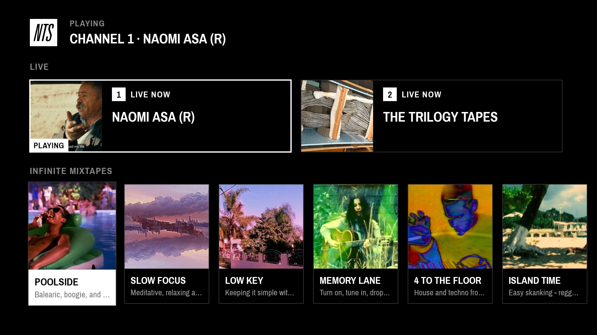

<h1 align="center">NTS for Android TV</h1>
<p align="center">An unofficial NTS Radio player for Android TV and Google TV, made for the remote.</p>
<p align="center">
  <a href="LICENSE"></a>
  
  
</p>

This is a fan project. It is not made by, affiliated with or endorsed by NTS, and the name and the logo belong to NTS. If you like NTS, [support them](https://www.nts.live/supporters). If you work at NTS and want anything changed or taken down, [open an issue](https://github.com/sanderjn/nts-tv/issues) and I will sort it out.

<p align="center">
  <a href="https://github.com/sanderjn/nts-tv/releases/latest/download/NTS-TV.apk"><b>Download NTS for Android TV</b></a>
</p>

Listen to [NTS](https://www.nts.live) on your TV: both live channels and the Infinite Mixtapes, picked with the remote. The music keeps playing when you go back to the home screen or the screensaver starts. No account needed.



## Other devices

[NTS for Mac](https://github.com/sanderjn/nts-mac): the same stations from the macOS menu bar, with Google Cast and AirPlay.

## Features

- **Live channels 1 and 2** with the show that is on now, plus all **Infinite Mixtapes**.
- **One screen, remote only:** OK plays a station, OK on the playing station pauses it.
- **Plays in the background**, and the play/pause button on the remote keeps working outside the app.
- **Stays on:** the TV does not fall asleep in the middle of a show, see [Keeping the TV awake](#keeping-the-tv-awake).
- **Recovers by itself** when the stream drops.

Made for the Google TV Streamer. It should run on any Android TV or Google TV device with Android 9 or later, but that is the only one it was tried on.

## Install

The app is not in the Play Store, so you install it over the network with `adb`. You need a computer on the same network as the TV, with [Android's platform tools](https://developer.android.com/tools/releases/platform-tools) installed.

1. On the TV, open **Settings → System → About** and press OK on **Android TV OS build** seven times. That unlocks the developer options.
2. Open **Settings → System → Developer options** and turn on **USB debugging**. Despite the name, this is also what lets `adb` connect over the network.
3. Find the TV's IP address under **Settings → Network & Internet**.
4. [Download NTS-TV.apk](https://github.com/sanderjn/nts-tv/releases/latest/download/NTS-TV.apk) and run, with the address of your TV:

```sh
adb connect 192.168.1.50
adb install NTS-TV.apk
```

The TV asks once if it may trust your computer. After that NTS is in your list of apps.

To update, download the new version and run `adb install -r NTS-TV.apk`.

### Keeping the TV awake

Android TV goes to sleep a fixed time after the last press on the remote, even while music plays, and switches the TV off with it. The app can lift that timeout for as long as it plays, if you allow it once:

```sh
adb shell pm grant nl.sanderjanssen.ntstv android.permission.WRITE_SECURE_SETTINGS
```

Without this the app works the same, but the TV goes to sleep after about twenty minutes. The app puts your own timeout back when you pause. The screensaver still starts, and switching the TV off stops the music.

## Building from source

Needs JDK 17 and the Android SDK (platform 35).

```sh
git clone https://github.com/sanderjn/nts-tv.git
cd nts-tv
./gradlew assembleRelease testDebugUnitTest
```

The app is in `app/build/outputs/apk/release/app-release.apk`, signed with your local debug key. Install the release build and not the debug one: Compose scrolls visibly slower in a debug build.

## How it works

Kotlin with Compose for TV. A Media3 `MediaSessionService` with one ExoPlayer plays the streams, and the screen talks to it through a `MediaController`. Shows and mixtapes come from the public `nts.live/api/v2/live` and `/mixtapes`; the two live streams are fixed, so they play even when that API is down.

| File | Purpose |
|---|---|
| `Station.kt` | The station model and the two live channels |
| `NtsApi.kt` | Fetching and parsing the NTS API |
| `PlaybackService.kt` | The media session, the player, retrying and the sleep timeout |
| `MainViewModel.kt` | The list of stations and the last one played |
| `MainActivity.kt` | The screen |

## License

MIT, see [LICENSE](LICENSE). The bundled typeface is [Archivo Narrow](https://github.com/Omnibus-Type/ArchivoNarrow), under the [SIL Open Font License](app/src/main/assets/ArchivoNarrow-OFL.txt).

NTS, the NTS logo and everything you hear and see from the stations belong to NTS. The logo is used here only to show what the app plays, and is not covered by the MIT license. If you like NTS, [support them](https://www.nts.live/supporters).
